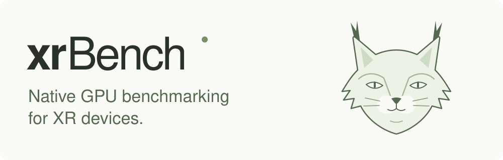

# xrBench



xrBench benchmarks all 221 native xrGPU operator identities on Android ARM64 XR
devices, using C++ and Vulkan/SPIR-V. The browser connects over USB, installs the
matched runner, displays typed correctness results, and exports finished native
reports. Completed results upload automatically through the website's protected
server relay into Supabase; JSON downloads remain available.

Visitors run benchmarks and download results JSON without email or sign-in.
Open [xrBench](https://xrbench.mickirusu.chatgpt.site/) at its standalone address.
The [hosting guide](docs/standalone-hosting.md) covers that owner-only Site; the
[deployment handoff](docs/deployment-readiness.md) also records the retained
portfolio section, protected receiver, durable quotas and shared Supabase project.
The automatic relay is live and verified through real HTTP submissions and
PostgreSQL receipts. That handoff distinguishes the deployment checks from
mocked frontend tests and pending physical-device qualification.

## Getting started

### Run a benchmark

Open a packaged xrBench site in desktop Chrome or Edge. Enable developer mode and
USB debugging on your device, connect a USB data cable, and select **Run**. Approve
USB access in the browser and debugging inside the headset.

After approving debugging, you can remove the headset. Isolated kernel execution
uses a foreground service and a bounded partial wake lock. Keep USB connected and
the browser tab open to receive progress. **Download results JSON** preserves a
copy. Results stay in this browser while automatic uploads retry. A database
outage never reruns a benchmark or removes its downloadable results.

Older apps and results are preserved during updates. If an unfinished browser
session belongs to an older release, select **Update runner**. Close other
headset tools if they already own the USB interface. No desktop ADB server or
maintainer commands are required by the website.

### Develop locally

Install Python 3.11–3.13, uv, Node.js, JDK 17+, and Docker Desktop. Start locally:

```sh
uv sync --locked --group dev
uv run python main.py
```

This starts PostgreSQL, prepares the signed runner and website when their sources
change, and opens [localhost:8765](http://localhost:8765/). Preparation uses the
verified sibling xrGPU native package when available, otherwise builds the pinned
xrGPU revision. The first build needs network access and read access to xrGPU.
The local signing key stays private in `engine/.state/browser-signing/`; keep it
to retain the same installation identity. Cached releases run without source downloads.

The separate developer dashboard remains available with `--developer` on port
8766. It is independent of the browser USB flow.

## Project structure

```text
src/       Browser interfaces
engine/    Native runner, device control, and reports
engine/workloads/  Historical model fixtures and CPU correctness references
server/    Report receiver
scripts/   Packaging and verification
docs/      Guides and workflows
```

## Documentation

[Browse the guides](docs/) for development, browser releases, measurements,
and device qualification.

The public suite uses one fixture per operator, including typed and multiple
outputs; it is not the complete 13,919-case contract conformance suite. Unsupported
capabilities remain explicit. Quest 3 USB update, unworn correctness, and sustained
performance validation are pending physical-device evidence. Existing OpenXR frame
measurements still require a worn, focused headset. xrGPU database pulling is not
implemented. See [testing.md](testing.md) for validation gates.
